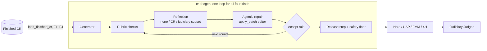

/pulse:skip-review

> **Draft.** This PR merges under Clayton's size exception. Clayton merged judiciary's half (#487). Elliot approves the CR changes, and CN reviews `src/cr/note/`.

## This is what we did

One harness, `cr docgen --kind {note,uap,fmm,4h}`, replaces four pipelines. Before this PR, each pipeline had its own CR loader, checks, repair and judge wiring.



- **One set of contracts.** `docgen/adapter.py` holds them all: `FinishedCR`, `DocumentAdapter`, `Draft`, `Artifact`, `Finding`, `EditableFinding` and `ReflectionSubset`.
- **Static checks enforce the pipeline rules.** basedpyright and `scripts/check_docgen_boundary.py` (in the CI `seam` job) reject five errors:
  - The editor gets a finding that it cannot repair.
  - An adapter uses the cartridge subset or the outputs of a different kind.
  - Judiciary reflection runs without its worker settings.
  - A module imports from a layer that it must not use.
  - Code makes a `FinishedCR` outside its loader.
- **No reward hacking.** The editor never gets these findings:
  - a finding that only card evidence can clear
  - a result finding outside the card that holds the result
  - a major finding that the second sample did not report again

  Confirmation matches each claim, not only each key. The loop stops after a finished round that changes no file.
- **Deleted:** the per-pipeline CLIs and stores, the legacy projection dev CLIs, the CR-37 note renderer, the UAP optimizer and CR's C3 agreement tool.
- **Size:** source +7,017/−7,064, so the source is 47 lines smaller than main. Tests +10,858/−5,467. 218 commits.

## How it works

Links point to `3758b090`. A **draft** is the writable files at one point in the run. A **round** is one editor session, then reflection, then the accept rule. **Reflection** is the adapter's code checks plus each configured reflector. A **floor finding** has `floor=True`: it is one of CR's own guardrails.

### 1. One run, end to end

[`run_document`](https://github.com/Function-Health/function-intelligence/blob/3758b0901c4f85ad955e1a6f0cb02804c838147b/projects/clinical-reasoning/src/cr/docgen/loop.py#L119-L289) makes one document from one `FinishedCR`:

```python
proj = await adapter.project(cr)                       # the existing generator
ws = Workspace(adapter.seeds(cr, proj), adapter.writable(proj))
current = before = await reflect(())                   # code checks, then the reflectors
kept = [(0, current, ws.writable_files())]             # round 0 is the projection
for n in range(1, limits.max_edit_rounds + 1):
    if not editable(current.findings) or _unfixable(current): break
    if edits and _stalled(before, current): break
    record = await edit(editor, n, "review", current, reflect)
    #   editor.edit(...), reflect again (skipped if unchanged or rejects_early), keep or restore
    if record.lost: break                              # the floor blocks below
    before = current
    if record.kept: current = record.after; kept.append(...)
    elif _idle(record): break
restore kept[accept.settle(...)]                       # only LastClean picks an earlier draft
if release and not _floors(current):                   # the release step
    current = await audit(current.findings)            # a release blocking finding -> floor
    for n in range(1, limits.release_edits + 1):       # while a fixable floor finding remains:
        await edit(editor, n, "release", current, audit)  # kept: current = record.after
floor = _floor(adapter, d, current.findings, checks)   # released | fallback | blocked
return DocumentResult(document=adapter.render(d), artifact=artifact(), ...)
# cli.py then writes the files: outputs.write_outputs, or the note's own writer
```

The edit rounds stop at the first rule that holds ([L227-L242](https://github.com/Function-Health/function-intelligence/blob/3758b0901c4f85ad955e1a6f0cb02804c838147b/projects/clinical-reasoning/src/cr/docgen/loop.py#L227-L242)):

| Rule | The loop stops when |
|---|---|
| No editable finding | No `EditableFinding` remains. A blocking finding that is not editable never starts a round. |
| No fixable floor | [`_unfixable`](https://github.com/Function-Health/function-intelligence/blob/3758b0901c4f85ad955e1a6f0cb02804c838147b/projects/clinical-reasoning/src/cr/docgen/loop.py#L69-L71): a floor finding remains, and no writable file holds it. |
| Round limit | The round number reaches `Limits.max_edit_rounds`. The default is 3. The note gets its limit from its policy. |
| Lost editor call | The session stops with `model_error`. `edit` restores the files. No later round, `settle` or release step runs, and the floor blocks. |
| Stall | [`_stalled`](https://github.com/Function-Health/function-intelligence/blob/3758b0901c4f85ad955e1a6f0cb02804c838147b/projects/clinical-reasoning/src/cr/docgen/loop.py#L110-L116): no blocking finding remains, and each editable key was an editable minor key before the round. After a reverted round, it holds whenever no blocking finding remains. |
| Idle round | [`_idle`](https://github.com/Function-Health/function-intelligence/blob/3758b0901c4f85ad955e1a6f0cb02804c838147b/projects/clinical-reasoning/src/cr/docgen/loop.py#L101-L107): the accept rule did not keep the round, and its session finished with no file changed. |

- `rejects_early` does not stop the loop. It skips the reflectors for one round when the code checks alone already make `keep` false ([L210-L215](https://github.com/Function-Health/function-intelligence/blob/3758b0901c4f85ad955e1a6f0cb02804c838147b/projects/clinical-reasoning/src/cr/docgen/loop.py#L210-L215)).
- [`by_files`](https://github.com/Function-Health/function-intelligence/blob/3758b0901c4f85ad955e1a6f0cb02804c838147b/projects/clinical-reasoning/src/cr/docgen/loop.py#L145-L159) caches the code checks and the artifact by writable-file content. So the check tool, `finish`, reflection and the floor share one result per draft. The adapters also cache by draft content: the note's checks and note text, the UAP's prose and plan, and the FMM and 4H checks. `CachedJudge` asks the UAP advisory judge once per distinct prose.

### 2. The contracts

| Type | Holds | Made by |
|---|---|---|
| [`FinishedCR`](https://github.com/Function-Health/function-intelligence/blob/3758b0901c4f85ad955e1a6f0cb02804c838147b/projects/clinical-reasoning/src/cr/finished_cr.py#L36-L51) | The ledger, the CRP packet, the member record and the checkpoint path. | Only [`load_finished_cr`](https://github.com/Function-Health/function-intelligence/blob/3758b0901c4f85ad955e1a6f0cb02804c838147b/projects/clinical-reasoning/src/cr/finished_cr.py#L116-L139), after the checks F1 to F4. One reviewed test fixture is the other caller. |
| [`Draft`](https://github.com/Function-Health/function-intelligence/blob/3758b0901c4f85ad955e1a6f0cb02804c838147b/projects/clinical-reasoning/src/cr/docgen/adapter.py#L143-L147) | The CR, the adapter's projection and the `Workspace`. Each adapter hook on a draft takes one. | `run_document`, once per run. |
| [`Artifact`](https://github.com/Function-Health/function-intelligence/blob/3758b0901c4f85ad955e1a6f0cb02804c838147b/projects/clinical-reasoning/src/cr/docgen/adapter.py#L122-L140) | The document judiciary grades, as CR's native JSON. A UAP plan also holds card evidence by action and by file. | `adapter.artifact`. It gives `None` while the draft does not render. |
| [`DocumentAdapter`](https://github.com/Function-Health/function-intelligence/blob/3758b0901c4f85ad955e1a6f0cb02804c838147b/projects/clinical-reasoning/src/cr/docgen/adapter.py#L252-L290), [`ReportingAdapter`](https://github.com/Function-Health/function-intelligence/blob/3758b0901c4f85ad955e1a6f0cb02804c838147b/projects/clinical-reasoning/src/cr/docgen/adapter.py#L293-L303) | The hooks of one kind: `project`, `seeds`, `writable`, `editor`, `code_checks`, `rendered`, `artifact`, `fallback`, `render`. `ReportingAdapter` adds `report` and `trace`. | `ClinicianNoteAdapter`, `UapAdapter` and `OneShotAdapter`. Only the last two report: the note writes its own files. |
| [`Reflector`](https://github.com/Function-Health/function-intelligence/blob/3758b0901c4f85ad955e1a6f0cb02804c838147b/projects/clinical-reasoning/src/cr/docgen/adapter.py#L240-L249), [`Reflection`](https://github.com/Function-Health/function-intelligence/blob/3758b0901c4f85ad955e1a6f0cb02804c838147b/projects/clinical-reasoning/src/cr/docgen/adapter.py#L216-L237) | `reflect(draft, artifact, previous)` gives a `Reflection`: findings, keys not evaluated, a meter and run records. | The CR reflectors and `JudiciaryReflector`. The loop's `reflect` joins their reflections. |
| [`Editor`](https://github.com/Function-Health/function-intelligence/blob/3758b0901c4f85ad955e1a6f0cb02804c838147b/projects/clinical-reasoning/src/cr/docgen/adapter.py#L199-L213), [`EditRun`](https://github.com/Function-Health/function-intelligence/blob/3758b0901c4f85ad955e1a6f0cb02804c838147b/projects/clinical-reasoning/src/cr/docgen/adapter.py#L163-L196) | `edit(draft, number, findings, ...)` takes only `EditableFinding`s. Its `EditRun` holds the stop reason, turns, meter, patches, refusals and tool calls. | `EditorSpec` and `NoteAuthorEditor`. |
| [`EditRecord`](https://github.com/Function-Health/function-intelligence/blob/3758b0901c4f85ad955e1a6f0cb02804c838147b/projects/clinical-reasoning/src/cr/docgen/adapter.py#L314-L335) | One round: its `EditRun`, `kept`, the reflection after it and `changed`. `lost` reads the stop reason. | The loop's `edit`. |
| [`AcceptRule`](https://github.com/Function-Health/function-intelligence/blob/3758b0901c4f85ad955e1a6f0cb02804c838147b/projects/clinical-reasoning/src/cr/docgen/accept.py#L29-L52) | `keep`, `rejects_early`, `reflects_unchanged` and `settle`. | `LastClean` and `StrictImprovement`. |
| [`Limits`](https://github.com/Function-Health/function-intelligence/blob/3758b0901c4f85ad955e1a6f0cb02804c838147b/projects/clinical-reasoning/src/cr/docgen/adapter.py#L306-L311) | `max_edit_rounds` (default 3) and `release_edits` (default 0). | The note's `review_limits`. The other kinds use the defaults. |
| [`DocumentResult`](https://github.com/Function-Health/function-intelligence/blob/3758b0901c4f85ad955e1a6f0cb02804c838147b/projects/clinical-reasoning/src/cr/docgen/adapter.py#L338-L403), [`FloorResult`](https://github.com/Function-Health/function-intelligence/blob/3758b0901c4f85ad955e1a6f0cb02804c838147b/projects/clinical-reasoning/src/cr/docgen/adapter.py#L150-L156) | The document, the final draft, the identity, each reflection and round, `restored_to`, the artifact and the meters. The `FloorResult` is `released`, `fallback` or `blocked`, with a reason. | `run_document`. `_floor` makes the `FloorResult`, except after a lost call. |
| [`ReflectionSubset`](https://github.com/Function-Health/function-intelligence/blob/3758b0901c4f85ad955e1a6f0cb02804c838147b/projects/clinical-reasoning/src/cr/docgen/adapter.py#L76-L119), [`CartridgePolicy`](https://github.com/Function-Health/function-intelligence/blob/3758b0901c4f85ad955e1a6f0cb02804c838147b/projects/clinical-reasoning/src/cr/docgen/adapter.py#L61-L73) | One kind, one published `JudgeRef`, and one policy per cartridge in request order. A policy holds `fail_closed`, `decision`, `not_editable` and `evidence_bound`. | Each adapter module, as a constant. A duplicate cartridge id raises. |
| [`Kind`](https://github.com/Function-Health/function-intelligence/blob/3758b0901c4f85ad955e1a6f0cb02804c838147b/projects/clinical-reasoning/src/cr/docgen/adapter.py#L32-L49) and its literals | The four kinds. `artifact_kind` gives judiciary's name for each (`uap_plan` for the UAP). `NoteKind`, `UapKind`, `FmmKind` and `FourHorsemenKind` each name one kind. | Type aliases. basedpyright uses them to reject a mix of kinds. |

### 3. Findings and editability

[`Finding`](https://github.com/Function-Health/function-intelligence/blob/3758b0901c4f85ad955e1a6f0cb02804c838147b/projects/clinical-reasoning/src/cr/docgen/findings.py#L27-L67) holds `key`, `blocking`, `source`, `where` (a writable path or `None`), `quote`, `input_fact`, `why`, `hint`, `severity`, `decided` and `floor`.
- **`blocking`** counts in the accept score, the stall rule and `LastClean.settle`. A blocking code-check finding also makes `EditorSpec` refuse `finish`.
- **`floor`** marks a CR guardrail. The floor releases a draft only when no floor finding remains. No judiciary finding sets `floor`.
- **[`EditableFinding`](https://github.com/Function-Health/function-intelligence/blob/3758b0901c4f85ad955e1a6f0cb02804c838147b/projects/clinical-reasoning/src/cr/docgen/findings.py#L70-L76)** is the only type the editor takes. [`classify`](https://github.com/Function-Health/function-intelligence/blob/3758b0901c4f85ad955e1a6f0cb02804c838147b/projects/clinical-reasoning/src/cr/docgen/findings.py#L79-L88) is its only maker. It needs its producer's word that the files can repair the finding, and a `where` or `whole_document`. Only the note's adapter sets `whole_document`.

[`JudiciaryReflector._reflect`](https://github.com/Function-Health/function-intelligence/blob/3758b0901c4f85ad955e1a6f0cb02804c838147b/projects/clinical-reasoning/src/cr/docgen/judiciary.py#L528-L607) applies these rules. The last four reasons come from the [H1 result](https://github.com/Function-Health/function-intelligence/blob/3758b0901c4f85ad955e1a6f0cb02804c838147b/projects/clinical-reasoning/docs/design/document-harness.md#L277-L320), where the editor gamed the Judge.

| Rule | Code | Why |
|---|---|---|
| The reflector puts each finding in the first writable file whose rendered text holds its quote. With no such file, the finding is not editable. | [`_quoted_in`](https://github.com/Function-Health/function-intelligence/blob/3758b0901c4f85ad955e1a6f0cb02804c838147b/projects/clinical-reasoning/src/cr/docgen/judiciary.py#L653-L656) | The editor can change only writable text. |
| A key in `not_editable` is never editable. | [`_fixable`](https://github.com/Function-Health/function-intelligence/blob/3758b0901c4f85ad955e1a6f0cb02804c838147b/projects/clinical-reasoning/src/cr/docgen/judiciary.py#L621-L633) | UAP `actionable_result_unnamed` quotes the plan's first line. The editor put bare result names in the overview, which the Judge never credits. |
| A key in `evidence_bound` is editable only in a card file whose `file_evidence` holds its `input_fact`. | [`_held`](https://github.com/Function-Health/function-intelligence/blob/3758b0901c4f85ad955e1a6f0cb02804c838147b/projects/clinical-reasoning/src/cr/docgen/judiciary.py#L614-L618) | An overview edit named results with no card, to clear `must_address_result_unaddressed`. |
| A refuted major is not editable. It is a model major whose claim is in neither the last kept reflection nor the second sample. | [L602-L604](https://github.com/Function-Health/function-intelligence/blob/3758b0901c4f85ad955e1a6f0cb02804c838147b/projects/clinical-reasoning/src/cr/docgen/judiciary.py#L602-L604) | The editor deleted a true clause to clear a false positive that the second sample did not repeat. |
| A claim is (cartridge, key, place). The place is the file, else the folded quote, else the folded input fact. | [`_claim`](https://github.com/Function-Health/function-intelligence/blob/3758b0901c4f85ad955e1a6f0cb02804c838147b/projects/clinical-reasoning/src/cr/docgen/judiciary.py#L640-L650) | With only cartridge and key, a new finding on one card blocked because of an earlier finding on another card. |

### 4. Reflection modes

| `--reflection` | Reflectors in the rounds | Release step | Kinds |
|---|---|---|---|
| `none` | None: the code checks only. | None. | All. The default for `fmm` and `4h`. |
| `cr` | The note: `CrCartridgesReflector`. The UAP: `UapJudgeReflector`. | The note: `CrReleaseAudit`. The UAP: none. | `note` and `uap`, where it is the default. `fmm` and `4h` refuse it. |
| `judiciary` | One `JudiciaryReflector` on the kind's subset. | None. | All. For development and climbs only. |

- [`CrCartridgesReflector`](https://github.com/Function-Health/function-intelligence/blob/3758b0901c4f85ad955e1a6f0cb02804c838147b/projects/clinical-reasoning/src/cr/docgen/clinician_note.py#L376-L500) runs CR's note cartridges as a note-loop review round runs them, at `judge_major` or `judge_minor`. A code predicate can exclude a cartridge. Each failing check is a finding on its section's file. A major cartridge's finding is blocking and a floor finding, and the cartridge goes into `fired`.
- [`CrReleaseAudit`](https://github.com/Function-Health/function-intelligence/blob/3758b0901c4f85ad955e1a6f0cb02804c838147b/projects/clinical-reasoning/src/cr/docgen/clinician_note.py#L503-L527) runs the `fired` major cartridges again at `release_auditor`, on the draft that stands. With none fired, it sends no request.
- [`UapJudgeReflector`](https://github.com/Function-Health/function-intelligence/blob/3758b0901c4f85ad955e1a6f0cb02804c838147b/projects/clinical-reasoning/src/cr/docgen/uap.py#L594-L641) runs the pipeline's advisory UAP judge. Each flag is a minor finding on its card's file, so this reflector never blocks.

The judiciary worker ([`ReflectionWorker`](https://github.com/Function-Health/function-intelligence/blob/3758b0901c4f85ad955e1a6f0cb02804c838147b/projects/clinical-reasoning/src/cr/docgen/judiciary.py#L333-L468), and the worker's [`reflect`](https://github.com/Function-Health/function-intelligence/blob/3758b0901c4f85ad955e1a6f0cb02804c838147b/projects/judiciary/tools/run-reflection-worker.mjs#L354-L395)):
- **Start.** `run_adapter` starts one worker per run from the `--judiciary-worker` argv, with no shell. Its first line must be `cr-reflection-ready.v1` with `synthetic_only: true` and the pinned `PROTOCOL_DIGEST` ([`_check_ready`](https://github.com/Function-Health/function-intelligence/blob/3758b0901c4f85ad955e1a6f0cb02804c838147b/projects/clinical-reasoning/src/cr/docgen/judiciary.py#L323-L330)).
- **Request.** Each sample sends one JSON line ([L402-L443](https://github.com/Function-Health/function-intelligence/blob/3758b0901c4f85ad955e1a6f0cb02804c838147b/projects/clinical-reasoning/src/cr/docgen/judiciary.py#L402-L443)). It holds a new `request_id`, `synthetic: true`, the `JudgeRef` and the cartridge ids. It also holds the persona id, the artifact kind, the document, the record fingerprint and, for a UAP plan only, `uap_card_evidence`. [`ledger_fingerprint`](https://github.com/Function-Health/function-intelligence/blob/3758b0901c4f85ad955e1a6f0cb02804c838147b/projects/clinical-reasoning/src/cr/docgen/judiciary.py#L128-L133) hashes the name, value and unit of each biomarker result. The worker refuses a request whose fingerprint does not match its persona snapshot.
- **Reply.** [`parse_run`](https://github.com/Function-Health/function-intelligence/blob/3758b0901c4f85ad955e1a6f0cb02804c838147b/projects/clinical-reasoning/src/cr/docgen/judiciary.py#L247-L320) accepts only a synthetic, partial `cr-reflection-run.v1` that echoes the request's id, persona, kind, fingerprint and Judge. It also needs one `finding_hazards` entry per finding, which gives its severity.
- **Samples** ([L565-L584](https://github.com/Function-Health/function-intelligence/blob/3758b0901c4f85ad955e1a6f0cb02804c838147b/projects/clinical-reasoning/src/cr/docgen/judiciary.py#L565-L584)). The first sample runs each subset cartridge. A code-decided major blocks on that run. The reflector drops `credit` findings, and a minor finding never blocks. A model-decided major blocks only when its claim was blocking in the last kept reflection, or a second sample reports it again. The second sample runs only the cartridges with such a major.
- **Fail closed.** A refusal, a bad line, a timeout or an exit raises `JudiciaryWorkerError`. So does a `fail_closed` cartridge that fails to run in either sample. The CLI then exits 1 and writes no document.
- **Development only.** `cli.py` documents judiciary reflection as for development and climbs only. The worker grades only synthetic persona snapshots, and CR sends no member record.

### 5. The editor

[`EditorSpec.edit`](https://github.com/Function-Health/function-intelligence/blob/3758b0901c4f85ad955e1a6f0cb02804c838147b/projects/clinical-reasoning/src/cr/docgen/session.py#L73-L137) runs one session per round for the UAP, FMM and 4H, at `EDITOR_ROLE` (`gpt-6.1-sol`, `medium`).
- **Review file.** It writes `review/round-<n>.md` or `review/release-round-<n>.md` with [`review_file`](https://github.com/Function-Health/function-intelligence/blob/3758b0901c4f85ad955e1a6f0cb02804c838147b/projects/clinical-reasoning/src/cr/docgen/findings.py#L104-L142). The file puts blocking findings first, in one JSON array under the untrusted-data banner.
- **Tools** ([`tools`](https://github.com/Function-Health/function-intelligence/blob/3758b0901c4f85ad955e1a6f0cb02804c838147b/projects/clinical-reasoning/src/cr/docgen/session.py#L155-L189)): `apply_patch`, `read_file`, `list_files`, `search_files`, the adapter's check tool (`check_plan`, `check_fmm` or `check_4h`) and `finish`.
- **Writable files only.** [`Workspace.apply_patch`](https://github.com/Function-Health/function-intelligence/blob/3758b0901c4f85ad955e1a6f0cb02804c838147b/projects/clinical-reasoning/src/cr/docgen/workspace.py#L127-L164) refuses a read-only path, each delete, and a patch after which the file's parser fails. The parsers are JSON for FMM and 4H, and `parse_card` for UAP cards.
- **`finish`.** [`_finish`](https://github.com/Function-Health/function-intelligence/blob/3758b0901c4f85ad955e1a6f0cb02804c838147b/projects/clinical-reasoning/src/cr/docgen/session.py#L255-L266) refuses while the code checks report a blocking finding, up to `max_finish_refusals` (3) times. Then it accepts and sets `finished_with_blocking`. Reflector findings never make it refuse.
- **Stops.** An accepted `finish`, a lost call, an `incomplete` or `failed` status, a turn with no tool call after one nudge, or `max_turns` (48). A lost call and `failed` both set `model_error`, so the loop treats the round as lost.
- **Requests and metering.** Each request is stateless and replays the whole conversation, with the run's `prompt_cache_key`. [`MeteredResponsesClient`](https://github.com/Function-Health/function-intelligence/blob/3758b0901c4f85ad955e1a6f0cb02804c838147b/projects/clinical-reasoning/src/cr/docgen/session.py#L321-L339) meters each call into `EditRun.meter`, and the loop adds it to the `editor` role.

The note uses [`NoteAuthorEditor`](https://github.com/Function-Health/function-intelligence/blob/3758b0901c4f85ad955e1a6f0cb02804c838147b/projects/clinical-reasoning/src/cr/docgen/clinician_note.py#L284-L373), the note agent's reviser, instead:
- It copies the draft's sections into the note agent's own workspace when they differ, or when the loop restored the draft. It writes the note loop's `review/<stage>-<n>.md` with `review_markdown`, then runs one `run_author` session at the policy's `reviser` role, and copies the sections back. The prompt, the tools (`check_note`), the limits and the cache key are the note agent's. It ignores the harness's `check` and `cache_key`.

### 6. The accept rules

[`score`](https://github.com/Function-Health/function-intelligence/blob/3758b0901c4f85ad955e1a6f0cb02804c838147b/projects/clinical-reasoning/src/cr/docgen/accept.py#L22-L26) counts (code-decided blocking, model-decided blocking, minor) findings.

| | [`LastClean`](https://github.com/Function-Health/function-intelligence/blob/3758b0901c4f85ad955e1a6f0cb02804c838147b/projects/clinical-reasoning/src/cr/docgen/accept.py#L55-L71) | [`StrictImprovement`](https://github.com/Function-Health/function-intelligence/blob/3758b0901c4f85ad955e1a6f0cb02804c838147b/projects/clinical-reasoning/src/cr/docgen/accept.py#L74-L93) |
|---|---|---|
| `keep` | Each edit. | Only a lower score in lexicographic order, with no new code-decided blocking key and no new S5 or S4 model blocking key. |
| `rejects_early` | Never. | When the code checks alone add a code-decided blocking key, or do not lower the score. |
| `reflects_unchanged` | Yes. A model reflector can decide again. | No. The draft keeps its findings, and the loop does not keep the round. |
| `settle` | When the last kept draft has a blocking finding, restore the last kept draft with none. Round 0 counts. With none, keep the last. | Keep the last kept draft. |
| Kinds | The note. | The UAP, FMM and 4H. `run_adapter` makes it the default. |

### 7. Per-kind adapters

| Kind | `project` calls | Writable files | Code checks | Floor and fallback | Accept | Judiciary Judge and subset | Special |
|---|---|---|---|---|---|---|---|
| Note ([adapter](https://github.com/Function-Health/function-intelligence/blob/3758b0901c4f85ad955e1a6f0cb02804c838147b/projects/clinical-reasoning/src/cr/docgen/clinician_note.py#L530-L613)) | `write_clinician_note`, with one review round, no cartridges and no release audit. | `note/<section>.md`, one per section. | `run_checks` and `crp_caution_checks`. `note.failed` when the first draft wrote no section. | Major code checks that are not waivable, failed major CR cartridges and `note.failed`. No fallback. | `LastClean` | [`clinician-note@0.10.35`](https://github.com/Function-Health/function-intelligence/blob/3758b0901c4f85ad955e1a6f0cb02804c838147b/projects/clinical-reasoning/src/cr/docgen/clinician_note.py#L89-L103): 6 model cartridges, 3 fail closed. | The release step under `cr`. Limits from the policy. `report.json` lists `unresolved_judiciary_majors`. |
| UAP ([adapter](https://github.com/Function-Health/function-intelligence/blob/3758b0901c4f85ad955e1a6f0cb02804c838147b/projects/clinical-reasoning/src/cr/docgen/uap.py#L367-L565)) | `run_refined_plan` on the default seams, with the catalog and the cached advisory judge. | `cards/<rank>-<card id>.md` per non-review card, and `plan/overview.md`. | Unreadable card files, else each `certify_uap` violation and failed layer. Also a blank overview and a plan with no action. | Each code-check finding. Fallback: the seed prose, checked again. No fallback for a plan with no action. | `StrictImprovement` | [`uap-plan@0.1.12`](https://github.com/Function-Health/function-intelligence/blob/3758b0901c4f85ad955e1a6f0cb02804c838147b/projects/clinical-reasoning/src/cr/docgen/uap.py#L132-L158): 3 code and 5 model cartridges. All but `structure.uap-plan` fail closed. | The artifact is the DTO from `finish_realized_plan`, with card evidence. A failed layer has no file, so `_unfixable` stops the rounds. |
| FMM ([spec](https://github.com/Function-Health/function-intelligence/blob/3758b0901c4f85ad955e1a6f0cb02804c838147b/projects/clinical-reasoning/src/cr/docgen/fmm.py#L114-L131)) | `generate_fmm`'s first attempt: `prepare`, then `submit`. | `fmm/submission.json`, as indented JSON. | `decode` and `assess`. Hard and soft issues all block `finish`. | Parse errors and hard issues. No fallback. | `StrictImprovement` | [`fmm@0.1.0`](https://github.com/Function-Health/function-intelligence/blob/3758b0901c4f85ad955e1a6f0cb02804c838147b/projects/clinical-reasoning/src/cr/docgen/fmm.py#L41-L53): 2 code cartridges that fail closed, 2 model cartridges that do not. | The editor takes the place of the generator's second attempt. A lost projection call names only a bounded error category. |
| 4H ([spec](https://github.com/Function-Health/function-intelligence/blob/3758b0901c4f85ad955e1a6f0cb02804c838147b/projects/clinical-reasoning/src/cr/docgen/four_horsemen.py#L149-L165)) | `generate_four_horsemen`'s first attempt: `prepare`, then `submit`. | `4h/review.json`, as indented JSON. | `decode`, then `validate_output` on the overview and on each horseman alone. | Each error. No fallback. | `StrictImprovement` | [`four-horsemen@0.1.0`](https://github.com/Function-Health/function-intelligence/blob/3758b0901c4f85ad955e1a6f0cb02804c838147b/projects/clinical-reasoning/src/cr/docgen/four_horsemen.py#L42-L57): 1 code cartridge that fails closed, 2 model cartridges that do not. | The editor takes the place of the generator's second call. The seed `inputs/record_names.txt` holds the names a driver may carry. |

FMM and 4H share [`OneShotAdapter`](https://github.com/Function-Health/function-intelligence/blob/3758b0901c4f85ad955e1a6f0cb02804c838147b/projects/clinical-reasoning/src/cr/docgen/submission.py#L131-L212). Its seeds are the generator's system prompt and the prompt's data blocks. A lost projection call raises `TransportError`, and the run exits 1. The UAP `render` reuses the pipeline's own result when no prose changed. Its `report` raises when the graded plan is not the rendered plan.

### 8. Wiring

- [`main`](https://github.com/Function-Health/function-intelligence/blob/3758b0901c4f85ad955e1a6f0cb02804c838147b/projects/clinical-reasoning/src/cr/docgen/cli.py#L535-L571) gets a [`KindSpec`](https://github.com/Function-Health/function-intelligence/blob/3758b0901c4f85ad955e1a6f0cb02804c838147b/projects/clinical-reasoning/src/cr/docgen/cli.py#L511-L521) from [`KINDS`](https://github.com/Function-Health/function-intelligence/blob/3758b0901c4f85ad955e1a6f0cb02804c838147b/projects/clinical-reasoning/src/cr/docgen/cli.py#L525-L532), clears the kind's outputs, loads the `FinishedCR` and calls the kind's `run`. The mode is `cr` by default for the note and the UAP, else `none`. `main` requires the two judiciary flags with `judiciary`, and refuses them without it.
- [`run_adapter`](https://github.com/Function-Health/function-intelligence/blob/3758b0901c4f85ad955e1a6f0cb02804c838147b/projects/clinical-reasoning/src/cr/docgen/cli.py#L168-L223) maps the [`ReflectionConfig`](https://github.com/Function-Health/function-intelligence/blob/3758b0901c4f85ad955e1a6f0cb02804c838147b/projects/clinical-reasoning/src/cr/docgen/cli.py#L133) (`"none"`, `"cr"` or a [`JudiciaryReflection`](https://github.com/Function-Health/function-intelligence/blob/3758b0901c4f85ad955e1a6f0cb02804c838147b/projects/clinical-reasoning/src/cr/docgen/cli.py#L117-L128)) to reflectors and calls `run_document`. Under `judiciary`, it also gives the worker's run id and standard error to the trace.
- The note: [`_run_note`](https://github.com/Function-Health/function-intelligence/blob/3758b0901c4f85ad955e1a6f0cb02804c838147b/projects/clinical-reasoning/src/cr/docgen/cli.py#L298-L350) passes the CR cartridges and release audit, `LastClean` and `review_limits`. It writes `notes.json`, `report.json` and `trace.json`.
- The UAP, FMM and 4H: [`_run_kind`](https://github.com/Function-Health/function-intelligence/blob/3758b0901c4f85ad955e1a6f0cb02804c838147b/projects/clinical-reasoning/src/cr/docgen/cli.py#L373-L431) calls the kind's [`Setup`](https://github.com/Function-Health/function-intelligence/blob/3758b0901c4f85ad955e1a6f0cb02804c838147b/projects/clinical-reasoning/src/cr/docgen/cli.py#L368-L370), which gives a [`Wiring`](https://github.com/Function-Health/function-intelligence/blob/3758b0901c4f85ad955e1a6f0cb02804c838147b/projects/clinical-reasoning/src/cr/docgen/cli.py#L356-L363): the adapter, its subset and its CR reflectors. [`_one_shot`](https://github.com/Function-Health/function-intelligence/blob/3758b0901c4f85ad955e1a6f0cb02804c838147b/projects/clinical-reasoning/src/cr/docgen/cli.py#L434-L448) makes the FMM and 4H setups with a metered `projection` client. [`_run_uap`](https://github.com/Function-Health/function-intelligence/blob/3758b0901c4f85ad955e1a6f0cb02804c838147b/projects/clinical-reasoning/src/cr/docgen/cli.py#L468-L508) makes the policy, the catalog, the refine seams and the advisory judge.
- [`write_outputs`](https://github.com/Function-Health/function-intelligence/blob/3758b0901c4f85ad955e1a6f0cb02804c838147b/projects/clinical-reasoning/src/cr/docgen/outputs.py#L70-L81) writes the record views, `generation.json` and `trace.json`. It writes the document and the UAP card evidence only when the floor did not block.
- The exit code is 0 for a released document or a fallback. It is 1 for a block or a failed call or worker, and 2 for bad input, such as a CR that fails the bar. [`cr uap` and `cr fmm`](https://github.com/Function-Health/function-intelligence/blob/3758b0901c4f85ad955e1a6f0cb02804c838147b/projects/clinical-reasoning/src/cr/cli.py#L680-L681) call `cr docgen --kind uap` or `--kind fmm`, with `--reflection none`.

### 9. Static checks

[`tests/_docgen_type_contracts.py`](https://github.com/Function-Health/function-intelligence/blob/3758b0901c4f85ad955e1a6f0cb02804c838147b/projects/clinical-reasoning/tests/_docgen_type_contracts.py#L1-L62) is never imported or run. CI runs basedpyright strict on it with `reportUnnecessaryTypeIgnoreComment`, so each of these lines must stay a type error:
- **Only an `EditableFinding` reaches the editor.** [L36](https://github.com/Function-Health/function-intelligence/blob/3758b0901c4f85ad955e1a6f0cb02804c838147b/projects/clinical-reasoning/tests/_docgen_type_contracts.py#L36) gives `Editor.edit` a plain `Finding` list. [L37](https://github.com/Function-Health/function-intelligence/blob/3758b0901c4f85ad955e1a6f0cb02804c838147b/projects/clinical-reasoning/tests/_docgen_type_contracts.py#L37) gives it a `classify` result, whose type is `Finding`.
- **One kind binds an adapter and a subset.** [L51](https://github.com/Function-Health/function-intelligence/blob/3758b0901c4f85ad955e1a6f0cb02804c838147b/projects/clinical-reasoning/tests/_docgen_type_contracts.py#L51) pairs the UAP adapter with the FMM subset in `Wiring`. [L52](https://github.com/Function-Health/function-intelligence/blob/3758b0901c4f85ad955e1a6f0cb02804c838147b/projects/clinical-reasoning/tests/_docgen_type_contracts.py#L52) pairs the FMM adapter with the 4H subset.
- **One kind binds the runner.** [L53-L59](https://github.com/Function-Health/function-intelligence/blob/3758b0901c4f85ad955e1a6f0cb02804c838147b/projects/clinical-reasoning/tests/_docgen_type_contracts.py#L53-L59) gives `run_adapter` the UAP adapter and the FMM subset. [L61](https://github.com/Function-Health/function-intelligence/blob/3758b0901c4f85ad955e1a6f0cb02804c838147b/projects/clinical-reasoning/tests/_docgen_type_contracts.py#L61) gives `_run_kind` `Kind.UAP` and an FMM setup.
- **Only written kinds reach `Outputs`.** [L62](https://github.com/Function-Health/function-intelligence/blob/3758b0901c4f85ad955e1a6f0cb02804c838147b/projects/clinical-reasoning/tests/_docgen_type_contracts.py#L62) gives `Outputs` the note kind, which `write_outputs` does not write.

[`scripts/check_docgen_boundary.py`](https://github.com/Function-Health/function-intelligence/blob/3758b0901c4f85ad955e1a6f0cb02804c838147b/projects/clinical-reasoning/scripts/check_docgen_boundary.py#L40-L105) reads the AST with the standard library only, in the CI `seam` job. Its rules:
- `intra-docgen-import`: a docgen module imports only the modules its `DOCGEN_IMPORTS` row lists, and the table has no cycle. `sibling-adapter`: no adapter imports another.
- `core-generic`: the core (`adapter`, `findings`, `workspace`, `accept`, `session`, `loop`) imports no CLI, FMM, 4H, refine or `cr.uap_*` module.
- `note-edge`: only `clinician_note` and an allowlist import `cr.note.author` and `cr.note.loop`. `cli-entry`: only `cr.cli` imports `cr.docgen.cli`.
- `constructor`: only `finished_cr.py` and `tests/_crp_fixtures.py` call `FinishedCR(...)`, and only `findings.py` calls `EditableFinding(...)`. `star-import` and `unlisted-module`: no star import, and each docgen module has a table row.

### 10. Reading notes

These parts of the code need careful reading:
- **The stall rule after a revert** ([loop.py L230-L242](https://github.com/Function-Health/function-intelligence/blob/3758b0901c4f85ad955e1a6f0cb02804c838147b/projects/clinical-reasoning/src/cr/docgen/loop.py#L230-L242)). The loop sets `before = current` after each round, kept or not. So after a reverted round, `_stalled` holds when no blocking finding remains.
- **The floor changes the workspace** ([`_floor`](https://github.com/Function-Health/function-intelligence/blob/3758b0901c4f85ad955e1a6f0cb02804c838147b/projects/clinical-reasoning/src/cr/docgen/loop.py#L79-L98)). It can put in the fallback, run the checks, and put the draft back. `render` and `artifact` then read the state that `_floor` leaves.
- **The skip paths** ([loop.py L208-L216](https://github.com/Function-Health/function-intelligence/blob/3758b0901c4f85ad955e1a6f0cb02804c838147b/projects/clinical-reasoning/src/cr/docgen/loop.py#L208-L216)). When the loop skips reflection, it gives `keep` a reflection made from the earlier findings. So `StrictImprovement` never keeps that round.
- **Two sources of claims** ([`_reflect`](https://github.com/Function-Health/function-intelligence/blob/3758b0901c4f85ad955e1a6f0cb02804c838147b/projects/clinical-reasoning/src/cr/docgen/judiciary.py#L528-L607)). Earlier claims come from stored `Finding` fields. New claims come from `locate(quote)`. "Refuted" means a model major that does not block.
- **Two note workspaces** ([`NoteAuthorEditor`](https://github.com/Function-Health/function-intelligence/blob/3758b0901c4f85ad955e1a6f0cb02804c838147b/projects/clinical-reasoning/src/cr/docgen/clinician_note.py#L328-L361)). The editor compares revision counts to see a `LastClean` restore, and then copies the sections again.
- **The note under `--reflection judiciary`.** It runs no CR cartridges and no release audit. No judiciary finding sets `floor`, so a judiciary major does not stop a release. [`unresolved_judiciary_majors`](https://github.com/Function-Health/function-intelligence/blob/3758b0901c4f85ad955e1a6f0cb02804c838147b/projects/clinical-reasoning/src/cr/docgen/clinician_note.py#L627-L640) lists each judiciary major that blocks in `report.json`.

## This is why it's better

- **One repair loop.**
  - Each kind edits its draft, checks it again, and keeps the edit only when the result is better.
  - Before this PR, FMM regenerated the draft and 4H repaired it once. UAP and CN each had a separate loop.
- **Judges inside generation.**
  - A subset of the judiciary cartridges checks each draft during generation.
  - The same Judges then grade the final document.
  - This mode is opt-in, and only for development and climbs (ADR 0005).
- **One loop for four documents.** One loader, one loop, one meter and one CLI replace four of each. The source code has the same size.
- **Production does not change.** cr_service does not import `cr.docgen`.

**The clinician note against production.**
- The plan was pre-registered on 2026-10-06, with 23 members.
- gpt-6.1-sol and Opus labelled each note blind.

| Per note | Production | CR note agent |
|---|---|---|
| Agreed blind failures | 2.65 | 0.02 (p<0.001) |
| Judge majority majors | 6.61 | 0.13 |

`cr docgen --kind note` sends the same requests as `write_clinician_note` in all 14 scripted sessions. The baseline ran the #295 agent. Nobody graded the exact note code in this PR, or the note under `--reflection judiciary`.

**The harness against main.**
- The same frozen Judges graded both arms at k=3.
- Two labellers labelled each document blind.
- There were 5 members.

| Document | Judge charges | Blind defects | Result |
|---|---|---|---|
| FMM | 8 → 8 | 0 → 0 | Non-inferior |
| 4H | 3 → 1 | 0 → 1 | Non-inferior in substance. Both arms make the same call. The labellers set aside the production copy. |
| UAP, first run | 21 → 21 | 7 → 10 | Fails. The editor gamed a check. |
| **UAP, after the anti-gaming changes** | **21 → 16** | **7 → 7** | **Non-inferior on all four rules.** The gaming audit is clean. |

- **Cost per document:** UAP $0.75 → $1.30, FMM $0.34 → $0.38, 4H $0.24 → $0.32.
- **UAP edit rounds:** 15 in the first run, 5 after the anti-gaming changes.

## This is how we proved it

- **Pre-registration.** We locked the plan and each addendum before we saw a result. The total spend was $89.09.
- **Grading.** The same frozen Judges graded both arms. Two labellers labelled each document blind. An independent Opus audit checked each kept edit for gaming.
- **Parity.** All 31 parity tests pass. The model requests are byte-identical to the goldens.
- **Gates.** 4,249 CR tests, 1,272 harness tests and 74 root tests pass. ruff, basedpyright and the boundary checks are clean.
- **CI.**
  - `pr-size` fails by design.
  - The detect-secrets history scan flags synthetic test values in old commits. Both of these need the admin merge.
  - All 29 other checks pass, including the service tests.

## Merge danger

- **The harness is a two-way door.** cr_service does not call it.
- **Two folded defaults are one-way.**
  - #438 changes CR's default model to `gpt-6.1-sol`.
  - #424 sends every Responses call through one prompt-cache transport.
  - We did not measure either change in production. Elliot decides.
- **Edit loops can stop sooner.**
  - Under `none` and `cr`, the UAP, FMM and 4H loops stop after a finished round that changes no file.
  - No golden changes. The note loop does not stop early.
- **Dev CLIs.** `FinishedCR` refuses more CRs for FMM, 4H and CN, including CRs scanned before #431. This PR deletes the legacy dev CLIs.

## Known issues

- **Not held-out evidence.** We found the gaming paths on the same 5 members that the UAP result uses. A run on other members would make the result stronger.
- **Card selection.** The first drafts do not always pick the right cards. For example, no card names a positive ANA. That is generator work.
- **A misleading trace label.** For a UAP plan that needs clinician review, the harness trace says "released". This is a label error, not a floor gap.
- **F3.** It refuses CRs scanned before #431, because it binds to the rendered snapshot.
- **One skipped test.** The real judiciary-worker e2e test skips in CI.
- **Follow-ups from the adversarial review:**
  - separate types for draft and released artifacts
  - typed worker requests
  - one evaluation per draft

🤖 Generated with [Claude Code](https://claude.com/claude-code)

