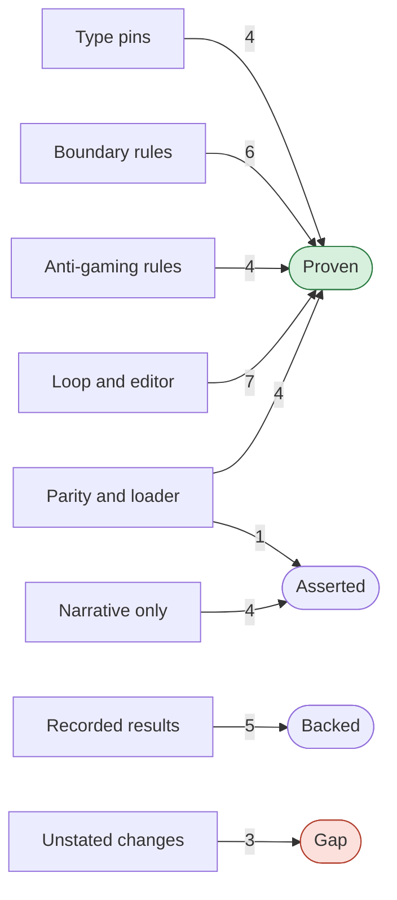

## Trust map

| Claim | Verdict | Why |
|---|---|---|
| C01: The editor takes only an EditableFinding. A plain Finding or a classify result is a type error. | **Proven** | V01 went red on control K01. |
| C02: Wiring rejects an adapter and a subset of different kinds. | **Proven** | V03 went red on control K03. |
| C03: run_adapter and _run_kind reject an adapter, a subset or a setup of a different kind. | **Proven** | V05 went red on control K05. |
| C04: Outputs rejects the note kind, because write_outputs does not write it. | **Proven** | V07 went red on control K07. |
| C05: A docgen module imports only the docgen modules that its DOCGEN_IMPORTS row lists. | **Proven** | V08 went red on control K08. |
| C06: No adapter imports another adapter. | **Proven** | V09 went red on control K09. |
| C07: The core imports no CLI, FMM, 4H, refine or cr.uap module. | **Proven** | V10 went red on control K10. |
| C08: Only clinician_note and the allowlist import cr.note.author and cr.note.loop. | **Proven** | V11 went red on control K11. |
| C09: Only finished_cr.py and tests/_crp_fixtures.py call FinishedCR. | **Proven** | V12 went red on control K12. |
| C10: Only findings.py calls EditableFinding. | **Proven** | V13 went red on control K13. |
| C11: The editor never gets a finding whose key is in not_editable. | **Proven** | V14 went red on control K14. |
| C12: An evidence_bound finding is editable only in a card file whose evidence holds its input fact. | **Proven** | V15 went red on control K15. |
| C13: The editor never gets a model major that the second sample did not report again. | **Proven** | V16 went red on control K16. |
| C14: A second report counts only for the same claim: the cartridge, the key and the place. | **Proven** | V17 went red on control K17. |
| C15: The edit rounds stop after a round that the accept rule did not keep and that changed no file. | **Proven** | V19 went red on control K19. |
| C16: A floor finding that no writable file holds stops the edit rounds. | **Proven** | V20 went red on control K20. |
| C17: A lost editor call never reflects or releases its partial edit. | **Proven** | V21 went red on control K21. |
| C18: The finish tool refuses while a code check reports a blocking finding, up to three times. | **Proven** | V22 went red on control K22. |
| C19: The editor cannot delete a writable file. | **Proven** | V23 went red on control K23. |
| C20: LastClean restores the last kept draft with no blocking finding, not the first. | **Proven** | V24 went red on control K24. |
| C21: The judiciary reflector refuses a worker that is not synthetic-only. | **Proven** | V25 went red on control K25. |
| C22: cr docgen sends model requests that are byte-identical to the golden file. | **Proven** | V26 went red on control K26. |
| C23: In the 14 scripted sessions, cr docgen --kind note sends the requests of write_clinician_note. | **Proven** | V27 went red on control K27. |
| C24: cr uap and cr fmm call cr docgen with --reflection none. | **Proven** | V28 went red on control K28. |
| C25: Each kind refuses a CR that fails CR-33 acceptance. | **Proven** | V29 went red on control K29. |
| C38: cr docgen --reflection judiciary works with the real judiciary reflection worker. | **Asserted** | Only the PR text states this claim. V36 is cannot-fail. |
| C26: Against production, the CR note agent cuts agreed blind failures from 2.65 to 0.02 per note. | **Backed** | V30 backs this claim, but the evidence is recorded, not run again. |
| C27: The harness is non-inferior to main for FMM, 4H and the UAP after the anti-gaming changes. | **Backed** | V31 backs this claim, but the evidence is recorded, not run again. |
| C28: An Opus audit found no gaming in the kept edits. | **Backed** | V32 backs this claim, but the evidence is recorded, not run again. |
| C29: The cost per document goes up: UAP $0.75 to $1.30, FMM $0.34 to $0.38, 4H $0.24 to $0.32. | **Backed** | V33 backs this claim, but the evidence is recorded, not run again. |
| C30: 4,249 CR tests, 1,272 harness tests and 74 root tests pass. Ruff, basedpyright and the boundary checks are clean. | **Backed** | V34 backs this claim, but the evidence is recorded, not run again. |
| C31: Production does not change, because cr_service does not import cr.docgen. | **Asserted** | Only the PR text states this claim. |
| C32: The source code is 47 lines smaller than main. | **Asserted** | Only the PR text states this claim. |
| C33: The UAP trace label released, on a plan that needs clinician review, is a label error and not a floor gap. | **Asserted** | Only the PR text states this claim. |
| C34: Nobody measured the two folded defaults, #438 and #424, in production. | **Asserted** | Only the PR text states this claim. |
| C35: require_same_scope refuses a packet and a ledger of different members or snapshots. | **Gap** | No verifier backs this claim, and the PR text does not state it. |
| C36: No caller uses sheet_names, which the PR deletes from guidance/_xlsx.py. | **Gap** | No verifier backs this claim, and the PR text does not state it. |
| C37: With diagnose, submission_text names the unexpected tool calls, not an empty body. | **Gap** | No verifier backs this claim, and the PR text does not state it. |

- **Verdicts:** 25 Proven, 5 Backed, 5 Asserted, 3 Gap.
- **Cannot fail:** V36 stayed green on control K36. It checks nothing that the control broke.
- **Controls:** 32 ran in scratch worktrees. Cost: $0, with no model call.
- **Control missed:** pin L36 stayed green when K01b widened Editor.edit, EditorSpec.edit and NoteAuthorEditor.edit. Project-wide basedpyright (V35) went red on the same edit.
- **Not run:** the evals and the Opus audit are recorded, not run again. Three of them use the author's model family.
