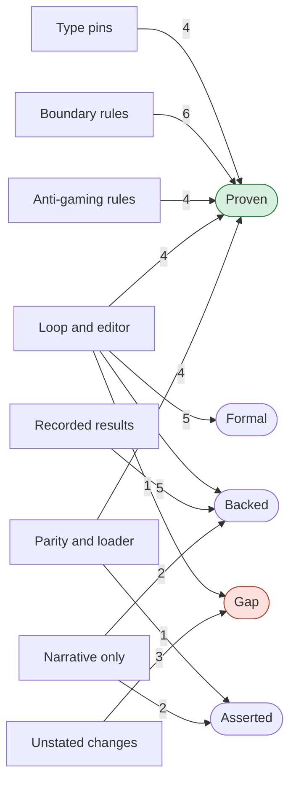

## Trust map

**Merge verdict: Not ready.** Do these first:

1. **Checked input, separate lanes**. Do not trust that one document can never mix two members.
2. **Bad edits never ship**. Ask a clinician to read the UAP plan that the trace marks released, because only the PR text says that the label is wrong.
3. **Same requests, working commands**. Judiciary mode is not verified, so do not rely on it yet: its only end-to-end test skips.

And 1 more: **Better notes, no production change**.

| Claim | Verdict | Tier | Why |
|---|---|---|---|
| [C01](https://github.com/Function-Health/function-intelligence/blob/3758b0901c4f85ad955e1a6f0cb02804c838147b/projects/clinical-reasoning/tests/_docgen_type_contracts.py#L33-L38): The editor takes only an EditableFinding. A plain Finding or a classify result is a type error. | **Proven** | 3 | V01 went red on control K01. |
| [C02](https://github.com/Function-Health/function-intelligence/blob/3758b0901c4f85ad955e1a6f0cb02804c838147b/projects/clinical-reasoning/tests/_docgen_type_contracts.py#L50-L52): Wiring rejects an adapter and a subset of different kinds. | **Proven** | 3 | V03 went red on control K03. |
| [C03](https://github.com/Function-Health/function-intelligence/blob/3758b0901c4f85ad955e1a6f0cb02804c838147b/projects/clinical-reasoning/tests/_docgen_type_contracts.py#L53-L61): run_adapter and _run_kind reject an adapter, a subset or a setup of a different kind. | **Proven** | 3 | V05 went red on control K05. |
| [C04](https://github.com/Function-Health/function-intelligence/blob/3758b0901c4f85ad955e1a6f0cb02804c838147b/projects/clinical-reasoning/tests/_docgen_type_contracts.py#L62): Outputs rejects the note kind, because write_outputs does not write it. | **Proven** | 3 | V07 went red on control K07. |
| [C05](https://github.com/Function-Health/function-intelligence/blob/3758b0901c4f85ad955e1a6f0cb02804c838147b/projects/clinical-reasoning/scripts/check_docgen_boundary.py#L44-L61): A docgen module imports only the docgen modules that its DOCGEN_IMPORTS row lists. | **Proven** | 3 | V08 went red on control K08. |
| [C06](https://github.com/Function-Health/function-intelligence/blob/3758b0901c4f85ad955e1a6f0cb02804c838147b/projects/clinical-reasoning/scripts/check_docgen_boundary.py#L62-L63): No adapter imports another adapter. | **Proven** | 3 | V09 went red on control K09. |
| [C07](https://github.com/Function-Health/function-intelligence/blob/3758b0901c4f85ad955e1a6f0cb02804c838147b/projects/clinical-reasoning/scripts/check_docgen_boundary.py#L64): The core imports no CLI, FMM, 4H, refine or cr.uap module. | **Proven** | 3 | V10 went red on control K10. |
| [C08](https://github.com/Function-Health/function-intelligence/blob/3758b0901c4f85ad955e1a6f0cb02804c838147b/projects/clinical-reasoning/scripts/check_docgen_boundary.py#L77-L81): Only clinician_note and the allowlist import cr.note.author and cr.note.loop. | **Proven** | 3 | V11 went red on control K11. |
| [C09](https://github.com/Function-Health/function-intelligence/blob/3758b0901c4f85ad955e1a6f0cb02804c838147b/projects/clinical-reasoning/scripts/check_docgen_boundary.py#L99-L105): Only finished_cr.py and tests/_crp_fixtures.py call FinishedCR. | **Proven** | 3 | V12 went red on control K12. |
| [C10](https://github.com/Function-Health/function-intelligence/blob/3758b0901c4f85ad955e1a6f0cb02804c838147b/projects/clinical-reasoning/scripts/check_docgen_boundary.py#L99-L105): Only findings.py calls EditableFinding. | **Proven** | 3 | V13 went red on control K13. |
| [C11](https://github.com/Function-Health/function-intelligence/blob/3758b0901c4f85ad955e1a6f0cb02804c838147b/projects/clinical-reasoning/src/cr/docgen/judiciary.py#L621-L633): The editor never gets a finding whose key is in not_editable. | **Proven** | 1 | V14 went red on control K14. |
| [C12](https://github.com/Function-Health/function-intelligence/blob/3758b0901c4f85ad955e1a6f0cb02804c838147b/projects/clinical-reasoning/src/cr/docgen/judiciary.py#L614-L618): An evidence_bound finding is editable only in a card file whose evidence holds its input fact. | **Proven** | 1 | V15 went red on control K15. |
| [C13](https://github.com/Function-Health/function-intelligence/blob/3758b0901c4f85ad955e1a6f0cb02804c838147b/projects/clinical-reasoning/src/cr/docgen/judiciary.py#L586-L604): The editor never gets a model major that the second sample did not report again. | **Proven** | 1 | V16 went red on control K16. |
| [C14](https://github.com/Function-Health/function-intelligence/blob/3758b0901c4f85ad955e1a6f0cb02804c838147b/projects/clinical-reasoning/src/cr/docgen/judiciary.py#L640-L650): A second report counts only for the same claim: the cartridge, the key and the place. | **Proven** | 1 | V17 went red on control K17. |
| [C15](https://github.com/Function-Health/function-intelligence/blob/3758b0901c4f85ad955e1a6f0cb02804c838147b/projects/clinical-reasoning/src/cr/docgen/loop.py#L101-L107): The edit rounds stop after a round that the accept rule did not keep and that changed no file. | **Gap** | - | code disagrees with the confirmed invariant L3; fix pending on understando/489-ready |
| [C16](https://github.com/Function-Health/function-intelligence/blob/3758b0901c4f85ad955e1a6f0cb02804c838147b/projects/clinical-reasoning/src/cr/docgen/loop.py#L69-L71): A floor finding that no writable file holds stops the edit rounds. | **Proven** | 1 | V20 went red on control K20. |
| [C17](https://github.com/Function-Health/function-intelligence/blob/3758b0901c4f85ad955e1a6f0cb02804c838147b/projects/clinical-reasoning/src/cr/docgen/loop.py#L219-L222): A lost editor call never reflects or releases its partial edit. | **Proven** | 1 | V21 went red on control K21. |
| [C18](https://github.com/Function-Health/function-intelligence/blob/3758b0901c4f85ad955e1a6f0cb02804c838147b/projects/clinical-reasoning/src/cr/docgen/session.py#L255-L266): The finish tool refuses while a code check reports a blocking finding, up to three times. | **Formal** | 4 | F489-3 is a rung 4 tla check. Its conformance link (uv run --no-sync pytest -q tests/test_formal_finish_replay.py) passes, and control K489-3a, K489-3b broke it. |
| [C19](https://github.com/Function-Health/function-intelligence/blob/3758b0901c4f85ad955e1a6f0cb02804c838147b/projects/clinical-reasoning/src/cr/docgen/workspace.py#L127-L156): The editor cannot delete a writable file. | **Proven** | 1 | V23 went red on control K23. |
| [C20](https://github.com/Function-Health/function-intelligence/blob/3758b0901c4f85ad955e1a6f0cb02804c838147b/projects/clinical-reasoning/src/cr/docgen/accept.py#L55-L71): LastClean restores the last kept draft with no blocking finding, not the first. | **Formal** | 5 | F489-1 is a rung 5 lean check. Its conformance link (uv run --no-sync pytest -q -rs tests/test_formal_accept_conformance.py) passes, and control K489-1a, K489-1b, K489-1c, K489-1d broke it. |
| [C21](https://github.com/Function-Health/function-intelligence/blob/3758b0901c4f85ad955e1a6f0cb02804c838147b/projects/clinical-reasoning/src/cr/docgen/judiciary.py#L323-L330): The judiciary reflector refuses a worker that is not synthetic-only. | **Proven** | 1 | V25 went red on control K25. |
| [C22](https://github.com/Function-Health/function-intelligence/blob/3758b0901c4f85ad955e1a6f0cb02804c838147b/projects/clinical-reasoning/tests/test_docgen_parity.py#L553-L566): cr docgen sends model requests that are byte-identical to the golden file. | **Proven** | 1 | V26 went red on control K26. |
| [C23](https://github.com/Function-Health/function-intelligence/blob/3758b0901c4f85ad955e1a6f0cb02804c838147b/projects/clinical-reasoning/tests/test_docgen_parity.py#L714-L730): In the 14 scripted sessions, cr docgen --kind note sends the requests of write_clinician_note. | **Proven** | 1 | V27 went red on control K27. |
| [C24](https://github.com/Function-Health/function-intelligence/blob/3758b0901c4f85ad955e1a6f0cb02804c838147b/projects/clinical-reasoning/src/cr/cli.py#L680-L681): cr uap and cr fmm call cr docgen with --reflection none. | **Proven** | 1 | V28 went red on control K28. |
| [C25](https://github.com/Function-Health/function-intelligence/blob/3758b0901c4f85ad955e1a6f0cb02804c838147b/projects/clinical-reasoning/src/cr/finished_cr.py#L105-L113): Each kind refuses a CR that fails CR-33 acceptance. | **Proven** | 1 | V29 went red on control K29. |
| [C38](https://github.com/Function-Health/function-intelligence/blob/3758b0901c4f85ad955e1a6f0cb02804c838147b/projects/clinical-reasoning/tests/test_docgen_judiciary_worker.py#L40): cr docgen --reflection judiciary works with the real judiciary reflection worker. | **Asserted** | - | Only the PR text states this claim. V36 is cannot-fail. |
| C26: Against production, the CR note agent cuts agreed blind failures from 2.65 to 0.02 per note. | **Backed** | - | V30 backs this claim, but the evidence is recorded, not run again. |
| C27: The harness is non-inferior to main for FMM, 4H and the UAP after the anti-gaming changes. | **Backed** | - | V31 backs this claim, but the evidence is recorded, not run again. |
| C28: An Opus audit found no gaming in the kept edits. | **Backed** | - | V32 backs this claim, but the evidence is recorded, not run again. |
| C29: The cost per document goes up: UAP $0.75 to $1.30, FMM $0.34 to $0.38, 4H $0.24 to $0.32. | **Backed** | - | V33 backs this claim, but the evidence is recorded, not run again. |
| C30: 4,249 CR tests, 1,272 harness tests and 74 root tests pass. Ruff, basedpyright and the boundary checks are clean. | **Backed** | - | V34 backs this claim, but the evidence is recorded, not run again. |
| C31: Production does not change, because cr_service does not import cr.docgen. | **Backed** | - | V37, V38 backs this claim, but it is a mechanical check (a grep or a line count) with no control. |
| C32: The source code is 47 lines smaller than main. | **Backed** | - | V39 backs this claim, but it is a mechanical check (a grep or a line count) with no control. |
| C33: The UAP trace label released, on a plan that needs clinician review, is a label error and not a floor gap. | **Asserted** | - | Only the PR text states this claim. |
| C34: Nobody measured the two folded defaults, #438 and #424, in production. | **Asserted** | - | Only the PR text states this claim. |
| [C35](https://github.com/Function-Health/function-intelligence/blob/3758b0901c4f85ad955e1a6f0cb02804c838147b/projects/clinical-reasoning/src/cr/generation_util.py#L47-L53): require_same_scope refuses a packet and a ledger of different members or snapshots. | **Gap** | - | No verifier backs this claim, and the PR text does not state it. |
| [C36](https://github.com/Function-Health/function-intelligence/blob/3758b0901c4f85ad955e1a6f0cb02804c838147b/projects/clinical-reasoning/src/cr/guidance/_xlsx.py#L16-L28): No caller uses sheet_names, which the PR deletes from guidance/_xlsx.py. | **Gap** | - | No verifier backs this claim, and the PR text does not state it. |
| [C37](https://github.com/Function-Health/function-intelligence/blob/3758b0901c4f85ad955e1a6f0cb02804c838147b/projects/clinical-reasoning/src/cr/generation_util.py#L15-L26): With diagnose, submission_text names the unexpected tool calls, not an empty body. | **Gap** | - | No verifier backs this claim, and the PR text does not state it. |
| C39: StrictImprovement keeps an edit only for a strictly lower score, with no new deterministic key and no new confirmed S5 or S4 key. | **Formal** | 5 | F489-1 is a rung 5 lean check. Its conformance link (uv run --no-sync pytest -q -rs tests/test_formal_accept_conformance.py) passes, and control K489-1a, K489-1b, K489-1c, K489-1d broke it. |
| C40: The accept score is compared lexicographically: a strict total order on the counts. | **Formal** | 5 | F489-1 is a rung 5 lean check. Its conformance link (uv run --no-sync pytest -q -rs tests/test_formal_accept_conformance.py) passes, and control K489-1a, K489-1b, K489-1c, K489-1d broke it. |
| C41: When rejects_early is true, keep reverts the edit whatever the reflectors add. | **Formal** | 5 | F489-1 is a rung 5 lean check. Its conformance link (uv run --no-sync pytest -q -rs tests/test_formal_accept_conformance.py) passes, and control K489-1a, K489-1b, K489-1c, K489-1d broke it. |
| C42: The edit rounds stop at max_edit_rounds and the release rounds at release_edits. | **Backed** | - | F489-2 backs this claim, but its formal record is Formal (pending). |
| C43: The floor releases only a draft with no floor finding, or a fallback that the code checks pass. | **Backed** | - | F489-2 backs this claim, but its formal record is Formal (pending). |

- **Verdicts:** 5 Formal, 22 Proven, 9 Backed, 3 Asserted, 4 Gap.
- **Promises:** Checked input, separate lanes: Gap, strongest check: tier 3, types, contracts or static rules. Bad edits never ship: Gap, strongest check: tier 5, proof with conformance. Same requests, working commands: Gap, strongest check: tier 1, e2e or integration test. Better notes, no production change: Asserted, strongest check: none. No check of this promise caught a planted bug. No gaming the Judge: Backed, strongest check: tier 3, types, contracts or static rules.
- **Cannot fail:** V36 stayed green on control K36. It checks nothing that the control broke.
- **Controls:** 44 ran in scratch worktrees. Cost: $0, with no model call.
- **Control missed:** pin L36 missed the bug when K01b widened Editor.edit, EditorSpec.edit and NoteAuthorEditor.edit. Project-wide basedpyright (V35) caught the same bug.
- **Not run:** the evals and the Opus audit are recorded, not run again. Three of them use the author's model family.
